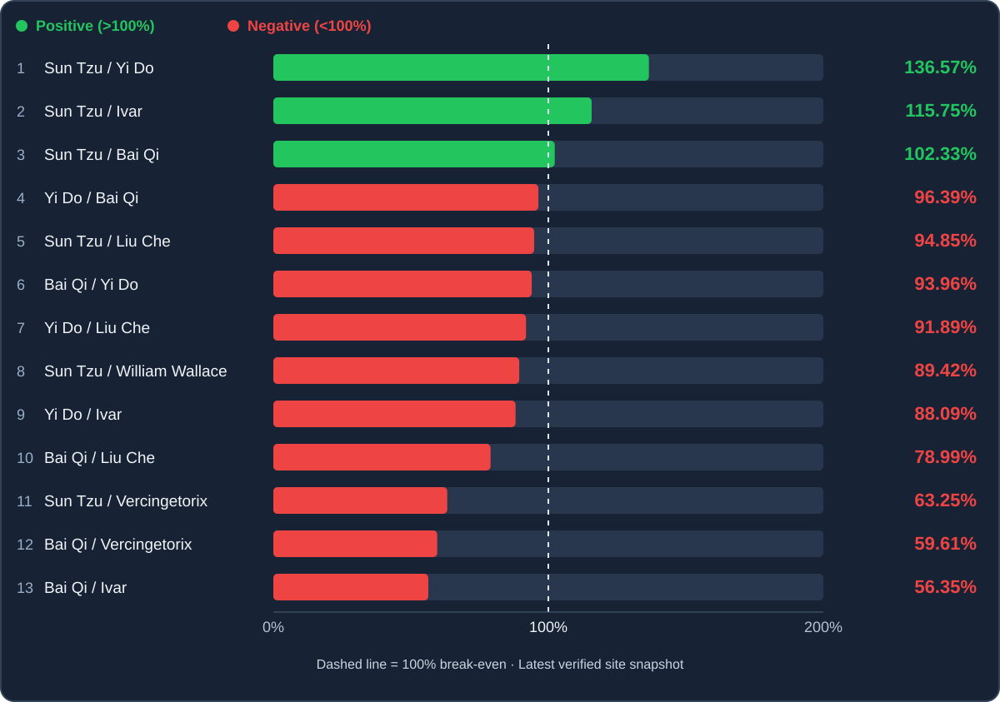

# RoK Combat Lab — Infantry Trade Report

**Workflow checked UTC:** 2026-11-21T09:58:43Z  
**API site-generated UTC:** 2026-11-21 08:25 UTC  
**Successful monitor checks:** 11/11  
**Fresh site snapshots (age <= 8h):** 11/11  
**Stale site snapshots:** 0/11  
**Scenario:** 7 Days / Open Field ([3,1]); rolling seven days, independent of eight-hour monitoring.

**Data age:** Successful API retrieval does NOT imply newly generated statistics. Snapshots older than 8 hours are marked STALE, even if retrievals succeed. Cache bypass cannot force an upstream data refresh.

## Trade Efficiency Ranking

## Trade Ranking & Battle Reports

| Rank | Commander Pairing | Trade % | Δ pp | Reports |
|---:|---|---:|---:|---:|
| 1 | [Sun Tzu / Yi Do](https://rokbattles.com/combat-lab?primary=595&secondary=621) | 139.18% | +0.24 | 335,050 |
| 2 | [Sun Tzu / Ivar](https://rokbattles.com/combat-lab?primary=595&secondary=596) | 123.12% | +0.72 | 178,859 |
| 3 | [Bai Qi / Yi Do](https://rokbattles.com/combat-lab?primary=545&secondary=621) | 116.32% | -0.99 | 32,457 |
| 4 | [Yi Do / Bai Qi](https://rokbattles.com/combat-lab?primary=621&secondary=545) | 103.55% | +0.06 | 27,878 |
| 5 | [Yi Do / Ivar](https://rokbattles.com/combat-lab?primary=621&secondary=596) | 100.11% | -0.14 | 3,870 |
| 6 | [Sun Tzu / Bai Qi](https://rokbattles.com/combat-lab?primary=595&secondary=545) | 99.13% | -0.33 | 849,414 |
| 7 | [Yi Do / Liu Che](https://rokbattles.com/combat-lab?primary=621&secondary=185) | 95.82% | +0.04 | 467,337 |
| 8 | [Sun Tzu / Liu Che](https://rokbattles.com/combat-lab?primary=595&secondary=185) | 95.59% | -0.38 | 238,392 |
| 9 | [Sun Tzu / Vercingetorix](https://rokbattles.com/combat-lab?primary=595&secondary=616) | 87.81% | -0.98 | 17,385 |
| 10 | [Bai Qi / Liu Che](https://rokbattles.com/combat-lab?primary=545&secondary=185) | 78.54% | +0.63 | 421,117 |
| 11 | [Bai Qi / Vercingetorix](https://rokbattles.com/combat-lab?primary=545&secondary=616) | 74.10% | -1.53 | 27,067 |

Site-generated: 2026-11-21 08:25 UTC · Retrieved: 11/11 · Fresh site snapshots: 11/11 · Stale site snapshots: 0/11 · Retained after errors: 0 · Unavailable: 0.

## Detailed Combat Statistics

KP Gained and KP Lost are in millions (M). DPS, SPS and TPS are per-second rates.

| Commander Pairing | KP Gained | KP Lost | DPS | SPS | TPS |
|---|---:|---:|---:|---:|---:|
| Sun Tzu / Yi Do | 6,293.137M | 4,521.513M | 481.231 | 82.252 | 58.315 |
| Sun Tzu / Ivar | 3,058.561M | 2,484.185M | 437.656 | 76.685 | 60.088 |
| Bai Qi / Yi Do | 418.410M | 359.698M | 350.985 | 59.997 | 49.714 |
| Yi Do / Bai Qi | 387.978M | 374.682M | 376.297 | 61.777 | 58.822 |
| Yi Do / Ivar | 45.347M | 45.297M | 337.998 | 54.783 | 56.188 |
| Sun Tzu / Bai Qi | 12,022.043M | 12,127.662M | 372.589 | 63.274 | 64.123 |
| Yi Do / Liu Che | 5,928.192M | 6,186.680M | 360.237 | 57.499 | 59.265 |
| Sun Tzu / Liu Che | 3,150.661M | 3,296.041M | 367.065 | 58.933 | 61.711 |
| Sun Tzu / Vercingetorix | 194.653M | 221.674M | 281.777 | 47.519 | 53.144 |
| Bai Qi / Liu Che | 5,223.506M | 6,650.926M | 350.524 | 57.334 | 72.608 |
| Bai Qi / Vercingetorix | 379.035M | 511.523M | 335.341 | 54.902 | 73.274 |

## Key Findings

**Best trade:** Sun Tzu / Yi Do at 139.18%. **Worst trade:** Bai Qi / Vercingetorix at 74.10%.
**Largest dataset:** Sun Tzu / Bai Qi (849,414 reports). **Smallest dataset:** Yi Do / Ivar (3,870 reports; interpret cautiously).
**Distinct-snapshot changes:** Sun Tzu / Yi Do +0.24 pp; Sun Tzu / Ivar +0.72 pp; Bai Qi / Yi Do -0.99 pp; Yi Do / Bai Qi +0.06 pp; Yi Do / Ivar -0.14 pp; Sun Tzu / Bai Qi -0.33 pp; Yi Do / Liu Che +0.04 pp; Sun Tzu / Liu Che -0.38 pp; Sun Tzu / Vercingetorix -0.98 pp; Bai Qi / Liu Che +0.63 pp; Bai Qi / Vercingetorix -1.53 pp.

**Source / monitor status:** [trades.json](data/trades.json) · [REPORT.md](REPORT.md) · Workflow checked: 2026-11-21T09:58:43Z · API generated: 2026-11-21 08:25 UTC · Retrievals: 11/11 · Fresh site data: 11/11 · Stale source: 0/11 · Historical data preserved; no 1-year baselines.
