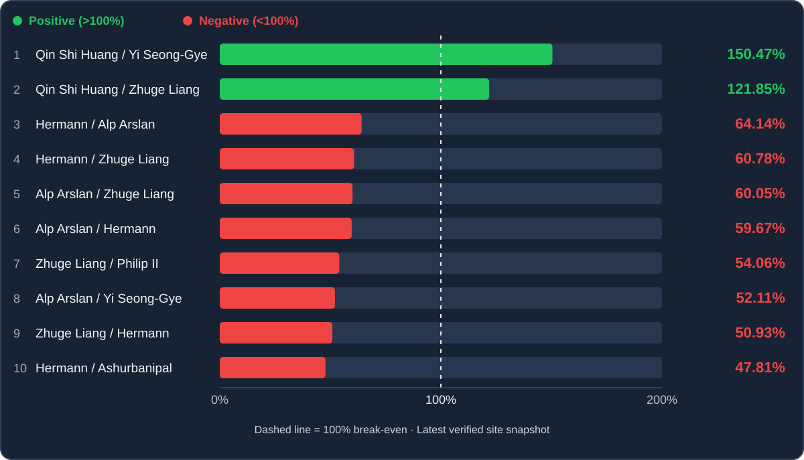

# RoK Combat Lab — Archer Trade Report

**Workflow checked UTC:** 2026-11-25T09:16:10Z  
**API site-generated UTC:** 2026-11-25 08:33 UTC  
**Successful monitor checks:** 9/9  
**Source verification:** API checks: 9/9; distinct site snapshots: 9/9; revised at same timestamp: 0/9; unchanged: 0/9; fresh site timestamps (<=8h): 9/9; stale site timestamps: 0/9  
**Fresh site snapshots (age <= 8h):** 9/9  
**Stale site snapshots:** 0/9  
**Scenario:** 7 Days / Open Field ([3,1]); rolling seven days, independent of eight-hour monitoring.

**Data age:** Successful API retrieval does NOT imply newly generated statistics. Snapshots older than 8 hours are marked STALE. Cache bypass cannot force an upstream refresh.

## Trade Efficiency Ranking

## Trade Ranking & Battle Reports

| Rank | Commander Pairing | Trade % | Δ pp | Reports | Site-generated UTC | Source status |
|---:|---|---:|---:|---:|---|---|
| 1 | [Qin Shi Huang / Yi Seong-Gye](https://rokbattles.com/combat-lab?primary=509&secondary=6) | 147.85% | +0.37 | 3,128,176 | 2026-11-25 08:33 UTC | Distinct site-generated snapshot; within 8h |
| 2 | [Qin Shi Huang / Zhuge Liang](https://rokbattles.com/combat-lab?primary=509&secondary=179) | 122.93% | -0.01 | 3,986,269 | 2026-11-25 08:33 UTC | Distinct site-generated snapshot; within 8h |
| 3 | [Hermann / Alp Arslan](https://rokbattles.com/combat-lab?primary=187&secondary=611) | 66.95% | -0.33 | 442,546 | 2026-11-25 08:33 UTC | Distinct site-generated snapshot; within 8h |
| 4 | [Hermann / Zhuge Liang](https://rokbattles.com/combat-lab?primary=187&secondary=179) | 62.53% | -0.14 | 210,957 | 2026-11-25 08:33 UTC | Distinct site-generated snapshot; within 8h |
| 5 | [Alp Arslan / Hermann](https://rokbattles.com/combat-lab?primary=611&secondary=187) | 60.15% | -0.04 | 431,732 | 2026-11-25 08:33 UTC | Distinct site-generated snapshot; within 8h |
| 6 | [Alp Arslan / Yi Seong-Gye](https://rokbattles.com/combat-lab?primary=611&secondary=6) | 59.62% | -0.17 | 53,455 | 2026-11-25 08:33 UTC | Distinct site-generated snapshot; within 8h |
| 7 | [Alp Arslan / Zhuge Liang](https://rokbattles.com/combat-lab?primary=611&secondary=179) | 59.02% | +0.27 | 203,647 | 2026-11-25 08:33 UTC | Distinct site-generated snapshot; within 8h |
| 8 | [Zhuge Liang / Hermann](https://rokbattles.com/combat-lab?primary=179&secondary=187) | 52.82% | +0.00 | 153,891 | 2026-11-25 08:33 UTC | Distinct site-generated snapshot; within 8h |
| 9 | [Zhuge Liang / Philip II](https://rokbattles.com/combat-lab?primary=179&secondary=459) | 52.31% | +0.09 | 129,902 | 2026-11-25 08:33 UTC | Distinct site-generated snapshot; within 8h |

Site-generated: 2026-11-25 08:33 UTC · Retrieved: 9/9 · Fresh site snapshots: 9/9 · Stale site snapshots: 0/9 · Retained after errors: 0 · Unavailable: 0.

## Detailed Combat Statistics

KP Gained and KP Lost are in millions (M). DPS, SPS and TPS are per-second rates.

| Commander Pairing | KP Gained | KP Lost | DPS | SPS | TPS |
|---|---:|---:|---:|---:|---:|
| Qin Shi Huang / Yi Seong-Gye | 48,347.996M | 32,700.358M | 399.626 | 59.178 | 39.624 |
| Qin Shi Huang / Zhuge Liang | 58,610.134M | 47,679.273M | 392.456 | 55.287 | 44.678 |
| Hermann / Alp Arslan | 4,308.191M | 6,435.242M | 274.577 | 42.962 | 63.573 |
| Hermann / Zhuge Liang | 1,819.643M | 2,909.933M | 254.088 | 38.501 | 61.243 |
| Alp Arslan / Hermann | 3,975.453M | 6,608.997M | 267.685 | 41.547 | 68.791 |
| Alp Arslan / Yi Seong-Gye | 537.614M | 901.747M | 340.248 | 52.347 | 88.209 |
| Alp Arslan / Zhuge Liang | 1,953.360M | 3,309.537M | 296.233 | 44.094 | 73.994 |
| Zhuge Liang / Hermann | 1,375.585M | 2,604.128M | 270.240 | 41.199 | 78.182 |
| Zhuge Liang / Philip II | 971.445M | 1,857.221M | 237.504 | 35.441 | 66.183 |

## Key Findings

**Best trade:** Qin Shi Huang / Yi Seong-Gye at 147.85%. **Worst trade:** Zhuge Liang / Philip II at 52.31%.
**Largest dataset:** Qin Shi Huang / Zhuge Liang (3,986,269 reports). **Smallest dataset:** Alp Arslan / Yi Seong-Gye (53,455 reports; interpret cautiously).
**Distinct-snapshot changes:** Qin Shi Huang / Yi Seong-Gye +0.37 pp; Qin Shi Huang / Zhuge Liang -0.01 pp; Hermann / Alp Arslan -0.33 pp; Hermann / Zhuge Liang -0.14 pp; Alp Arslan / Hermann -0.04 pp; Alp Arslan / Yi Seong-Gye -0.17 pp; Alp Arslan / Zhuge Liang +0.27 pp; Zhuge Liang / Hermann +0.00 pp; Zhuge Liang / Philip II +0.09 pp.

**Source / monitor status:** [trades_archer.json](data/trades_archer.json) · [REPORT_ARCHER.md](REPORT_ARCHER.md) · Workflow checked: 2026-11-25T09:16:10Z · API generated: 2026-11-25 08:33 UTC · Retrievals: 9/9 · Fresh site data: 9/9 · Stale source: 0/9 · Historical data preserved; no 1-year baselines.
