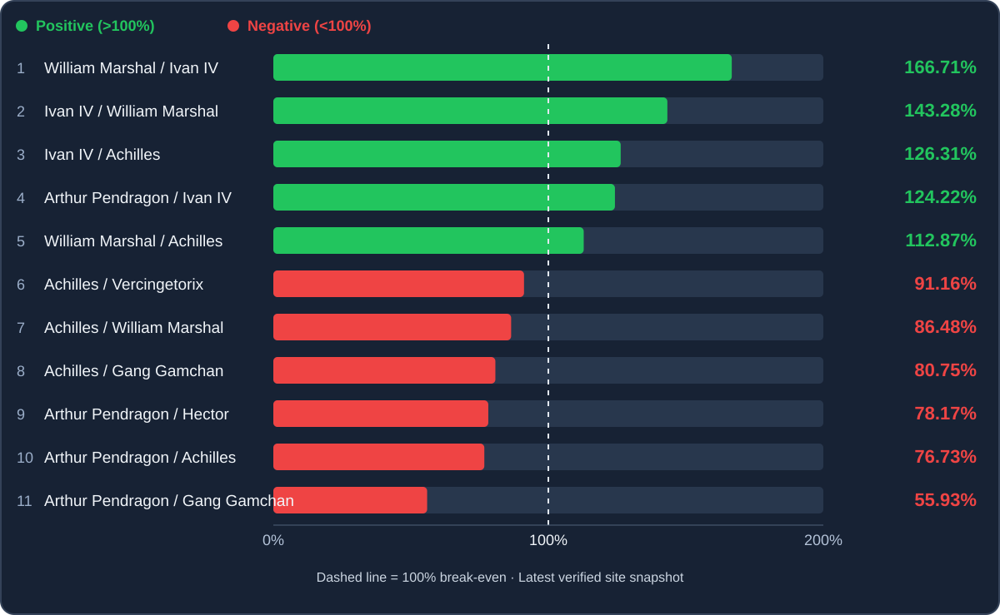

# RoK Combat Lab — Cavalry Trade Report

**Workflow checked UTC:** 2026-11-26T01:15:52Z  
**API site-generated UTC:** 2026-11-26 00:33 UTC  
**Successful monitor checks:** 11/11  
**Source verification:** API checks: 11/11; distinct site snapshots: 11/11; revised at same timestamp: 0/11; unchanged: 0/11; fresh site timestamps (<=8h): 11/11; stale site timestamps: 0/11  
**Fresh site snapshots (age <= 8h):** 11/11  
**Stale site snapshots:** 0/11  
**Scenario:** 7 Days / Open Field ([3,1]); rolling seven days, independent of eight-hour monitoring.

**Data age:** Successful API retrieval does NOT imply newly generated statistics. Snapshots older than 8 hours are marked STALE. Cache bypass cannot force an upstream refresh.

## Trade Efficiency Ranking

## Trade Ranking & Battle Reports

| Rank | Commander Pairing | Trade % | Δ pp | Reports | Site-generated UTC | Source status |
|---:|---|---:|---:|---:|---|---|
| 1 | [William Marshal / Ivan IV](https://rokbattles.com/combat-lab?primary=620&secondary=619) | 166.23% | +0.29 | 168,374 | 2026-11-26 00:33 UTC | Distinct site-generated snapshot; within 8h |
| 2 | [Ivan IV / William Marshal](https://rokbattles.com/combat-lab?primary=619&secondary=620) | 140.18% | -2.40 | 330,858 | 2026-11-26 00:33 UTC | Distinct site-generated snapshot; within 8h |
| 3 | [Ivan IV / Achilles](https://rokbattles.com/combat-lab?primary=619&secondary=575) | 127.30% | +0.91 | 984,146 | 2026-11-26 00:33 UTC | Distinct site-generated snapshot; within 8h |
| 4 | [Arthur Pendragon / Ivan IV](https://rokbattles.com/combat-lab?primary=540&secondary=619) | 123.60% | -0.60 | 2,518,119 | 2026-11-26 00:33 UTC | Distinct site-generated snapshot; within 8h |
| 5 | [William Marshal / Achilles](https://rokbattles.com/combat-lab?primary=620&secondary=575) | 114.34% | +1.41 | 71,382 | 2026-11-26 00:33 UTC | Distinct site-generated snapshot; within 8h |
| 6 | [Achilles / Vercingetorix](https://rokbattles.com/combat-lab?primary=575&secondary=616) | 88.90% | -2.59 | 98,790 | 2026-11-26 00:33 UTC | Distinct site-generated snapshot; within 8h |
| 7 | [Achilles / William Marshal](https://rokbattles.com/combat-lab?primary=575&secondary=620) | 85.51% | -1.03 | 211,875 | 2026-11-26 00:33 UTC | Distinct site-generated snapshot; within 8h |
| 8 | [Achilles / Gang Gamchan](https://rokbattles.com/combat-lab?primary=575&secondary=579) | 80.65% | -0.12 | 1,676,806 | 2026-11-26 00:33 UTC | Distinct site-generated snapshot; within 8h |
| 9 | [Arthur Pendragon / Achilles](https://rokbattles.com/combat-lab?primary=540&secondary=575) | 77.75% | +0.82 | 325,662 | 2026-11-26 00:33 UTC | Distinct site-generated snapshot; within 8h |
| 10 | [Arthur Pendragon / Hector](https://rokbattles.com/combat-lab?primary=540&secondary=576) | 76.79% | -1.25 | 228,862 | 2026-11-26 00:33 UTC | Distinct site-generated snapshot; within 8h |
| 11 | [Arthur Pendragon / Gang Gamchan](https://rokbattles.com/combat-lab?primary=540&secondary=579) | 57.09% | +0.76 | 73,045 | 2026-11-26 00:33 UTC | Distinct site-generated snapshot; within 8h |

Site-generated: 2026-11-26 00:33 UTC · Retrieved: 11/11 · Fresh site snapshots: 11/11 · Stale site snapshots: 0/11 · Retained after errors: 0 · Unavailable: 0.

## Detailed Combat Statistics

KP Gained and KP Lost are in millions (M). DPS, SPS and TPS are per-second rates.

| Commander Pairing | KP Gained | KP Lost | DPS | SPS | TPS |
|---|---:|---:|---:|---:|---:|
| William Marshal / Ivan IV | 3,341.136M | 2,009.895M | 519.707 | 85.921 | 50.861 |
| Ivan IV / William Marshal | 5,261.536M | 3,753.372M | 419.435 | 68.899 | 48.622 |
| Ivan IV / Achilles | 14,962.261M | 11,753.210M | 407.818 | 66.001 | 51.023 |
| Arthur Pendragon / Ivan IV | 40,214.708M | 32,537.050M | 461.542 | 73.390 | 58.662 |
| William Marshal / Achilles | 1,027.398M | 898.536M | 386.674 | 59.924 | 52.603 |
| Achilles / Vercingetorix | 1,090.354M | 1,226.460M | 298.158 | 46.117 | 51.410 |
| Achilles / William Marshal | 2,573.050M | 3,009.100M | 355.019 | 54.368 | 62.556 |
| Achilles / Gang Gamchan | 17,867.735M | 22,155.803M | 304.062 | 48.907 | 60.350 |
| Arthur Pendragon / Achilles | 4,543.065M | 5,843.154M | 414.085 | 63.149 | 81.870 |
| Arthur Pendragon / Hector | 2,829.496M | 3,684.669M | 373.814 | 57.487 | 73.860 |
| Arthur Pendragon / Gang Gamchan | 707.005M | 1,238.439M | 309.915 | 48.980 | 87.679 |

## Key Findings

**Best trade:** William Marshal / Ivan IV at 166.23%. **Worst trade:** Arthur Pendragon / Gang Gamchan at 57.09%.
**Largest dataset:** Arthur Pendragon / Ivan IV (2,518,119 reports). **Smallest dataset:** William Marshal / Achilles (71,382 reports; interpret cautiously).
**Distinct-snapshot changes:** William Marshal / Ivan IV +0.29 pp; Ivan IV / William Marshal -2.40 pp; Ivan IV / Achilles +0.91 pp; Arthur Pendragon / Ivan IV -0.60 pp; William Marshal / Achilles +1.41 pp; Achilles / Vercingetorix -2.59 pp; Achilles / William Marshal -1.03 pp; Achilles / Gang Gamchan -0.12 pp; Arthur Pendragon / Achilles +0.82 pp; Arthur Pendragon / Hector -1.25 pp; Arthur Pendragon / Gang Gamchan +0.76 pp.

**Source / monitor status:** [trades_cav.json](data/trades_cav.json) · [REPORT_CAV.md](REPORT_CAV.md) · Workflow checked: 2026-11-26T01:15:52Z · API generated: 2026-11-26 00:33 UTC · Retrievals: 11/11 · Fresh site data: 11/11 · Stale source: 0/11 · Historical data preserved; no 1-year baselines.
