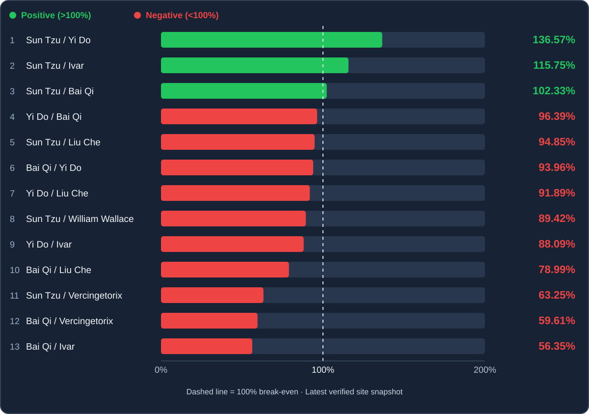

# RoK Combat Lab — Infantry Trade Report

**Workflow checked UTC:** 2026-11-24T17:15:33Z  
**API site-generated UTC:** 2026-11-24 16:32 UTC  
**Successful monitor checks:** 11/11  
**Source verification:** API checks: 11/11; distinct site snapshots: 11/11; revised at same timestamp: 0/11; unchanged: 0/11; fresh site timestamps (<=8h): 11/11; stale site timestamps: 0/11  
**Fresh site snapshots (age <= 8h):** 11/11  
**Stale site snapshots:** 0/11  
**Scenario:** 7 Days / Open Field ([3,1]); rolling seven days, independent of eight-hour monitoring.

**Data age:** Successful API retrieval does NOT imply newly generated statistics. Snapshots older than 8 hours are marked STALE, even if retrievals succeed. Cache bypass cannot force an upstream data refresh.

## Trade Efficiency Ranking

## Trade Ranking & Battle Reports

| Rank | Commander Pairing | Trade % | Δ pp | Reports | Site-generated UTC | Source status |
|---:|---|---:|---:|---:|---|---|
| 1 | [Sun Tzu / Yi Do](https://rokbattles.com/combat-lab?primary=595&secondary=621) | 137.37% | -0.14 | 1,402,491 | 2026-11-24 16:32 UTC | Distinct site-generated snapshot; within 8h |
| 2 | [Sun Tzu / Ivar](https://rokbattles.com/combat-lab?primary=595&secondary=596) | 117.02% | -0.17 | 442,361 | 2026-11-24 16:32 UTC | Distinct site-generated snapshot; within 8h |
| 3 | [Sun Tzu / Bai Qi](https://rokbattles.com/combat-lab?primary=595&secondary=545) | 102.34% | -0.17 | 2,507,919 | 2026-11-24 16:32 UTC | Distinct site-generated snapshot; within 8h |
| 4 | [Yi Do / Bai Qi](https://rokbattles.com/combat-lab?primary=621&secondary=545) | 99.79% | -0.26 | 128,141 | 2026-11-24 16:32 UTC | Distinct site-generated snapshot; within 8h |
| 5 | [Bai Qi / Yi Do](https://rokbattles.com/combat-lab?primary=545&secondary=621) | 98.39% | +0.99 | 138,548 | 2026-11-24 16:32 UTC | Distinct site-generated snapshot; within 8h |
| 6 | [Sun Tzu / Liu Che](https://rokbattles.com/combat-lab?primary=595&secondary=185) | 94.84% | +0.19 | 616,733 | 2026-11-24 16:32 UTC | Distinct site-generated snapshot; within 8h |
| 7 | [Yi Do / Liu Che](https://rokbattles.com/combat-lab?primary=621&secondary=185) | 92.92% | -0.31 | 1,724,568 | 2026-11-24 16:32 UTC | Distinct site-generated snapshot; within 8h |
| 8 | [Yi Do / Ivar](https://rokbattles.com/combat-lab?primary=621&secondary=596) | 91.21% | -0.04 | 10,410 | 2026-11-24 16:32 UTC | Distinct site-generated snapshot; within 8h |
| 9 | [Bai Qi / Liu Che](https://rokbattles.com/combat-lab?primary=545&secondary=185) | 78.84% | -0.10 | 1,362,327 | 2026-11-24 16:32 UTC | Distinct site-generated snapshot; within 8h |
| 10 | [Sun Tzu / Vercingetorix](https://rokbattles.com/combat-lab?primary=595&secondary=616) | 73.95% | -0.01 | 28,599 | 2026-11-24 16:32 UTC | Distinct site-generated snapshot; within 8h |
| 11 | [Bai Qi / Vercingetorix](https://rokbattles.com/combat-lab?primary=545&secondary=616) | 61.39% | -0.05 | 72,937 | 2026-11-24 16:32 UTC | Distinct site-generated snapshot; within 8h |

Site-generated: 2026-11-24 16:32 UTC · Retrieved: 11/11 · Fresh site snapshots: 11/11 · Stale site snapshots: 0/11 · Retained after errors: 0 · Unavailable: 0.

## Detailed Combat Statistics

KP Gained and KP Lost are in millions (M). DPS, SPS and TPS are per-second rates.

| Commander Pairing | KP Gained | KP Lost | DPS | SPS | TPS |
|---|---:|---:|---:|---:|---:|
| Sun Tzu / Yi Do | 24,726.662M | 18,000.633M | 452.559 | 74.776 | 53.892 |
| Sun Tzu / Ivar | 6,962.977M | 5,950.223M | 424.602 | 71.242 | 59.748 |
| Sun Tzu / Bai Qi | 35,746.680M | 34,929.753M | 382.588 | 63.627 | 62.192 |
| Yi Do / Bai Qi | 1,648.008M | 1,651.522M | 347.470 | 57.249 | 56.669 |
| Bai Qi / Yi Do | 1,576.958M | 1,602.682M | 307.173 | 49.701 | 50.103 |
| Sun Tzu / Liu Che | 7,883.894M | 8,312.953M | 365.913 | 57.379 | 60.484 |
| Yi Do / Liu Che | 21,577.949M | 23,222.059M | 352.091 | 55.789 | 59.328 |
| Yi Do / Ivar | 144.600M | 158.538M | 372.926 | 58.627 | 69.909 |
| Bai Qi / Liu Che | 16,500.104M | 20,928.753M | 345.384 | 55.466 | 70.153 |
| Sun Tzu / Vercingetorix | 301.495M | 407.709M | 278.291 | 46.251 | 60.859 |
| Bai Qi / Vercingetorix | 790.989M | 1,288.566M | 288.599 | 46.284 | 74.137 |

## Key Findings

**Best trade:** Sun Tzu / Yi Do at 137.37%. **Worst trade:** Bai Qi / Vercingetorix at 61.39%.
**Largest dataset:** Sun Tzu / Bai Qi (2,507,919 reports). **Smallest dataset:** Yi Do / Ivar (10,410 reports; interpret cautiously).
**Distinct-snapshot changes:** Sun Tzu / Yi Do -0.14 pp; Sun Tzu / Ivar -0.17 pp; Sun Tzu / Bai Qi -0.17 pp; Yi Do / Bai Qi -0.26 pp; Bai Qi / Yi Do +0.99 pp; Sun Tzu / Liu Che +0.19 pp; Yi Do / Liu Che -0.31 pp; Yi Do / Ivar -0.04 pp; Bai Qi / Liu Che -0.10 pp; Sun Tzu / Vercingetorix -0.01 pp; Bai Qi / Vercingetorix -0.05 pp.

**Source / monitor status:** [trades_inf.json](data/trades_inf.json) · [REPORT_INF.md](REPORT_INF.md) · Workflow checked: 2026-11-24T17:15:33Z · API generated: 2026-11-24 16:32 UTC · Retrievals: 11/11 · Fresh site data: 11/11 · Stale source: 0/11 · Historical data preserved; no 1-year baselines.
